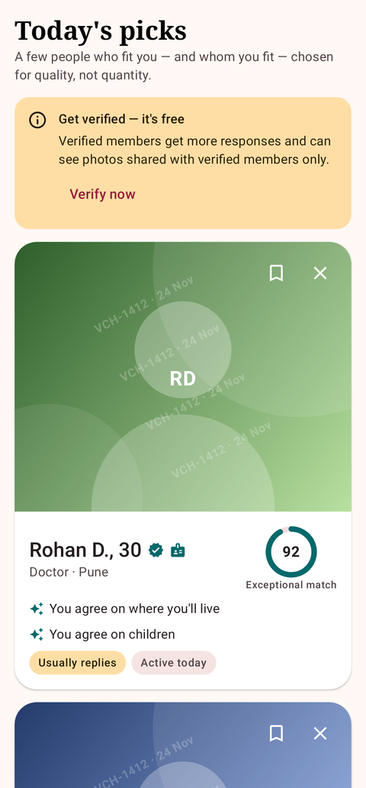
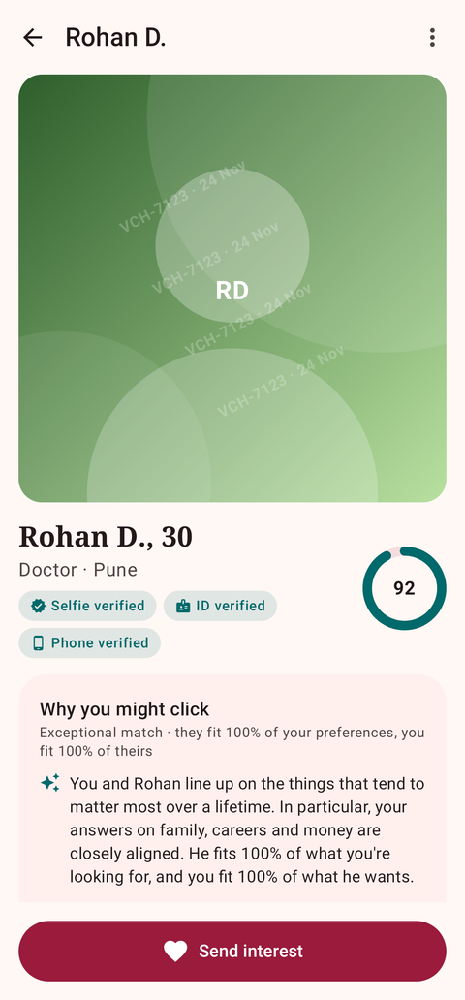
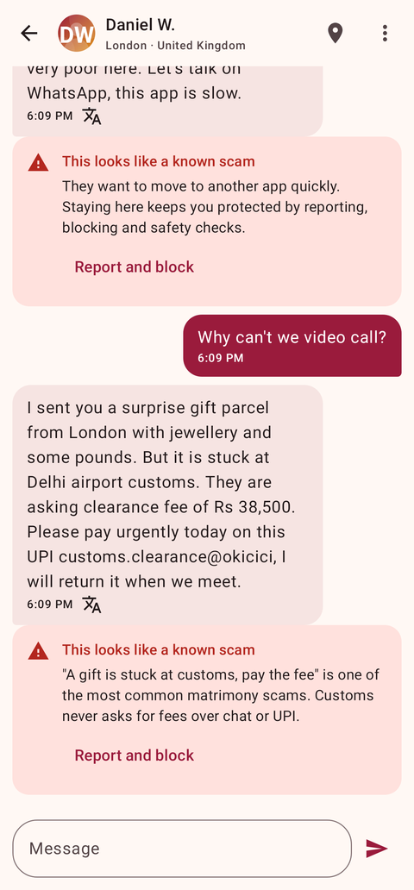
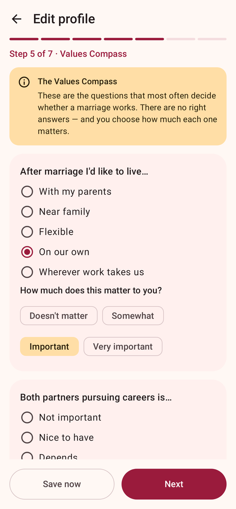
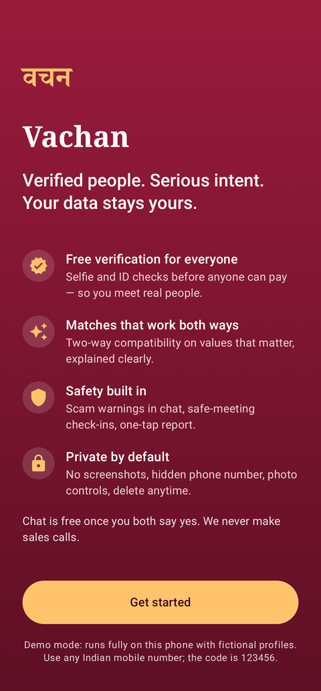
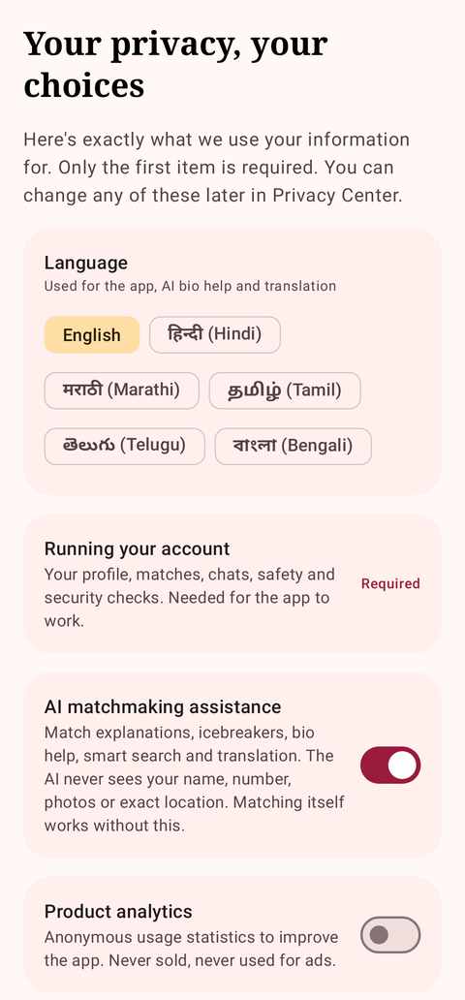
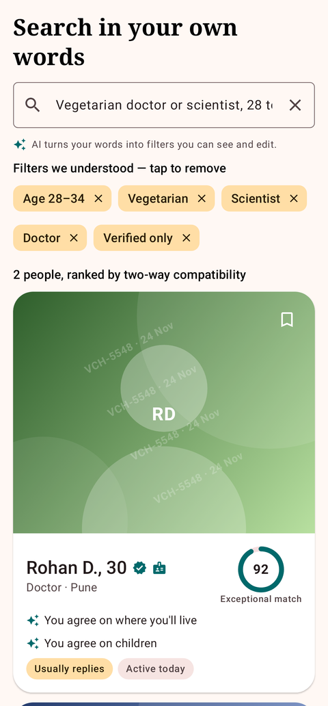
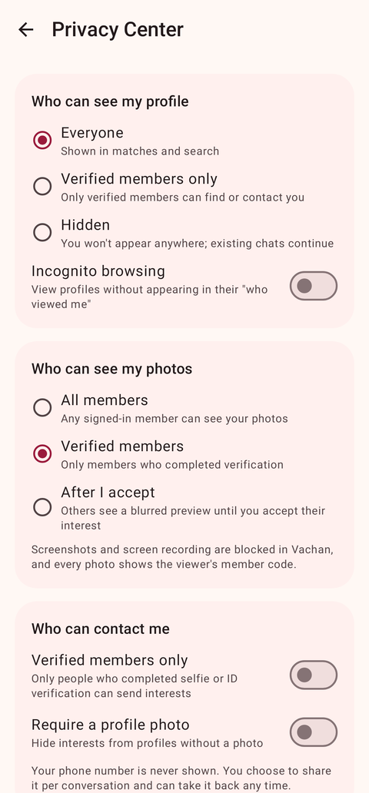

# Vachan — a privacy-first, AI-assisted matrimony app for India

*Vachan* (वचन, "a promise") is a working title. This folder is a self-contained project: a native
Android app (Kotlin + Jetpack Compose) and a Firebase backend in `asia-south1` (Mumbai), with a
provider-agnostic AI layer. It lives in the `pxpipe` repository but shares nothing with it.

> **Verified people. Serious intent. Your data stays yours.**

| | |
|---|---|
| Why it exists, what users complain about, where the market is going | [docs/RESEARCH.md](docs/RESEARCH.md) |
| What we're building and why (every feature traced to a gap) | [docs/PRODUCT_SPEC.md](docs/PRODUCT_SPEC.md) |
| Threat model, controls, DPDP compliance map | [docs/SECURITY_PRIVACY.md](docs/SECURITY_PRIVACY.md) |

## What's in the box

**Matchmaking**
- **Reciprocal compatibility engine**: scores A→B *and* B→A and combines them with a harmonic
  mean, so a match ranks high only if it works for both people. Transparent factor breakdown
  ("why you might click"), plus frictions worth discussing early.
- **Values Compass**: 12 questions on what actually breaks marriages (living arrangement,
  careers, children, money, household roles, parents' role, mental health…), each weighted by
  how much it matters to the person.
- **Daily Picks**: a few diversified, two-way-compatible introductions a day instead of endless
  swiping. A bounded on-device learner adapts factor weights to behaviour and explains what it
  learned (with a reset).
- **Natural-language search**: "vegetarian doctor in Pune, 28–33, open to relocating" → editable
  filter chips → deterministic search.

**AI assistance** (consent-gated, de-identified, never decides who is shown)
- Match insights, icebreakers, bio writer, smart search parsing, kind decline drafts, chat
  translation and the "Ask Vachan" assistant.
- One gateway, swappable providers: Anthropic (default `claude-opus-5-5`), OpenAI, Gemini, or a
  self-hosted OpenAI-compatible model (vLLM / Ollama). Offline templates take over whenever AI
  is off or unavailable.

**Safety**
- On-device **Safety Copilot** that recognises matrimonial scam scripts (customs-fee parcels,
  investment/crypto, emergencies, OTP requests, off-platform pressure — incl. Hinglish) and warns
  the reader. Outgoing nudges before sharing numbers, UPI IDs or OTPs.
- Free verification (selfie liveness flow, DigiLocker/Aadhaar-offline hook, work email),
  report/block, "Meet safely" plan + check-in timer, server-side fan-out detection.

**Privacy**
- Screenshot/recording blocking, viewer-watermarked photos, photo privacy levels, phone number
  shared only by consent (revocable), app lock for shared phones, encrypted storage (Tink +
  Android Keystore), no backups, memory-only Firestore cache.
- No client listing of profiles (anti-scraping), server-only trust fields, per-purpose consent
  with history, data export, 30-day deletion with hard purge.

**Fairness and honesty in the business model**: chat is free after mutual interest, verification
is free, no sales calls, no pay-to-see-contact.

## Screenshots

Rendered with Robolectric from the real screens against the Demo backend (see
[Testing](#testing)).

| Daily Picks | Why you might click | Safety Copilot | Values Compass |
|---|---|---|---|
|  |  |  |  |

| Welcome | Consent | Search | Privacy Center |
|---|---|---|---|
|  |  |  |  |

## Project layout

```
matrimony-android/
├── app/                         Android app (single module, Kotlin + Compose, Hilt)
│   └── src/main/java/com/vachan/app/
│       ├── core/model/          Domain models (Profile, Values Compass, Interest, Consent…)
│       ├── core/matching/       CompatibilityEngine, Recommender, PreferenceLearner, QueryParser
│       ├── core/safety/         ScamDetector (Safety Copilot), PiiDetector
│       ├── core/security/       SecureStore (Tink), AppLockManager, SecureWindow, DeviceIntegrity
│       ├── data/                Repository interfaces + Demo and Firebase backends
│       ├── di/                  Hilt wiring (Demo vs Firebase chosen at build time)
│       └── ui/                  Compose screens (onboarding, discover, chat, privacy, safety…)
├── firebase/
│   ├── firestore.rules          Default-deny access model
│   ├── storage.rules            Owner-only image uploads
│   ├── firestore.indexes.json   Indexes + TTL policies
│   ├── functions/               Cloud Functions (TypeScript): AI gateway, matching, safety, privacy
│   └── emulator-tests/          Security-rules and end-to-end tests against the emulators
└── docs/                        Research, product spec, security & privacy design
```

## Quick start (Demo mode — no backend needed)

Requirements: JDK 17+ (21 recommended), Android SDK with platform 37.

```bash
cd matrimony-android
./gradlew :app:installDebug        # or open the folder in Android Studio and Run
```

Without `app/google-services.json` the app builds in **Demo mode**: everything runs on the phone
against fictional members (illustrated avatars, no real photos). Sign in with any Indian mobile
number; the code is **123456**. Two conversations are seeded after onboarding — one genuine and
one scripted scam persona, so you can see the Safety Copilot react to a "customs fee" request.

## Connecting the real backend (Firebase, Mumbai)

1. Create a Firebase project. Create Firestore and Storage in **`asia-south1`**.
2. Enable **Phone** sign-in, and **App Check** with Play Integrity for the Android app
   (`com.vachan.app`; debug builds use `com.vachan.app.debug` and the App Check debug provider).
3. Download `google-services.json` into `app/` (it's git-ignored). The build switches to the
   Firebase backend automatically.
4. Configure and deploy the backend:

   ```bash
   cd firebase
   cp .firebaserc.example .firebaserc        # set your project id
   (cd functions && npm ci)
   firebase functions:secrets:set AI_API_KEY # your provider key
   firebase deploy --only firestore,storage,functions
   ```

   The service account running functions needs `iam.serviceAccounts.signBlob` to issue signed
   photo URLs. TTL policies are declared in `firestore.indexes.json`.

### Choosing the AI provider

Set these in `firebase/functions/.env.<project-id>` (non-secret) — no code changes needed:

| `AI_PROVIDER` | `AI_MODEL` | `AI_BASE_URL` | Notes |
|---|---|---|---|
| `anthropic` (default) | optional (default `claude-opus-5-5`) | — | Official SDK, structured outputs, low effort, server-side refusal fallback |
| `openai` | required | optional | Chat Completions with strict JSON schema |
| `gemini` | required | optional | Generative Language API, key sent in a header |
| `openai_compatible` | required | required | Self-hosted vLLM / Ollama / LM Studio — keeps data in your VPC |
| `mock` | — | — | Deterministic, for the emulator and tests |

Whatever the provider: prompts never contain names, phone numbers, photos, exact birth dates or
locations; user text is redacted and fenced; outputs are schema-validated and redacted again;
every call is consent-gated and quota-limited. Sign a data-processing agreement with no training
on your data before going live.

## Testing

```bash
# Android: core logic (engine, safety, parser, learner) + screen smoke tests
./gradlew :app:testDebugUnitTest
./gradlew :app:testDebugUnitTest --tests '*ScreenshotTest*' -Pscreenshots   # writes app/build/screenshots/*.png

# Cloud Functions unit tests (engine parity, redaction, scam heuristics, AI gateway, providers)
cd firebase/functions && npm ci && npm test

# Security rules + end-to-end flows against the Firebase emulators (needs Java)
cd firebase/emulator-tests && npm ci && npm test
```

The emulator scripts preload `scripts/loopback-direct.cjs` so firebase-tools can reach its own
local emulators when `HTTPS_PROXY` is set (it otherwise ignores `NO_PROXY`). It has no effect
without a proxy.

## Before launch

Honest list of what's designed and stubbed but not finished:

- **Vendor integrations**: selfie liveness + face match (with injection-attack detection),
  DigiLocker / Aadhaar offline verification (needs UIDAI/DigiLocker registration and legal
  review), transactional email for work-email codes, AI image forensics on photo uploads.
- **Photo upload pipeline** on the client (picker, EXIF stripping, upload); rules and signed-URL
  serving are done.
- **Push notifications** (FCM) honouring the private-notifications setting.
- **Play Billing** for Vachan Plus (auto-renew off by default).
- **Localisation**: extract strings; ship Hindi first, then eight more Indian languages.
- **E2EE chat** (phase 2; trade-offs in the security doc), admin moderation console, nightly
  response-rate computation, the co-manager's side of Family Mode.
- Penetration test, DPO/grievance officer appointment, incident-response runbook, fairness audit.

## Tech stack

Kotlin 2.4 · AGP 9.5 · Jetpack Compose (Material 3) · Hilt · Navigation (type-safe) · DataStore +
Tink · BiometricPrompt · Coil · Firebase (Auth, Firestore, Storage, Functions, App Check) ·
TypeScript 7 · zod · `@anthropic-ai/sdk` · Vitest · Robolectric. Dependencies are pinned to
releases at least two weeks old, and the Gradle distribution is checksum-verified.
